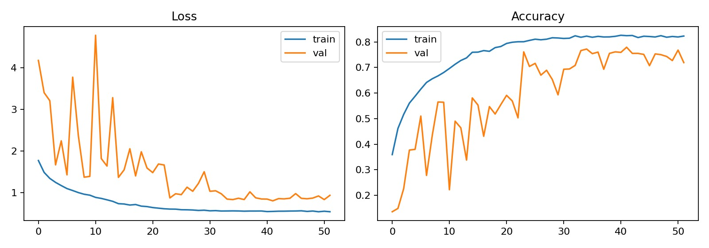
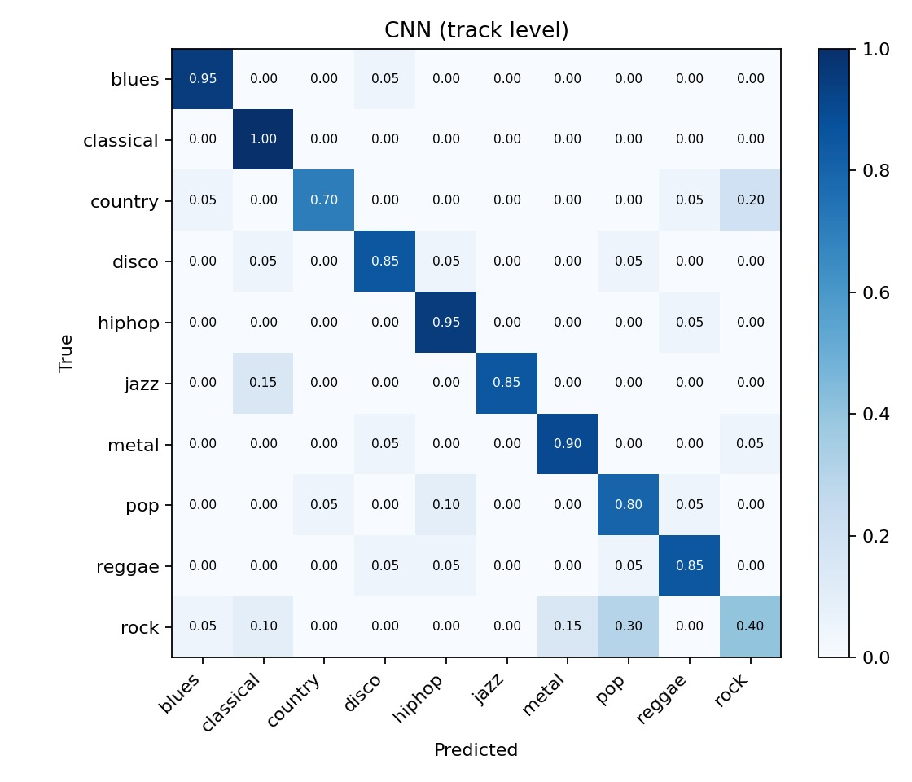
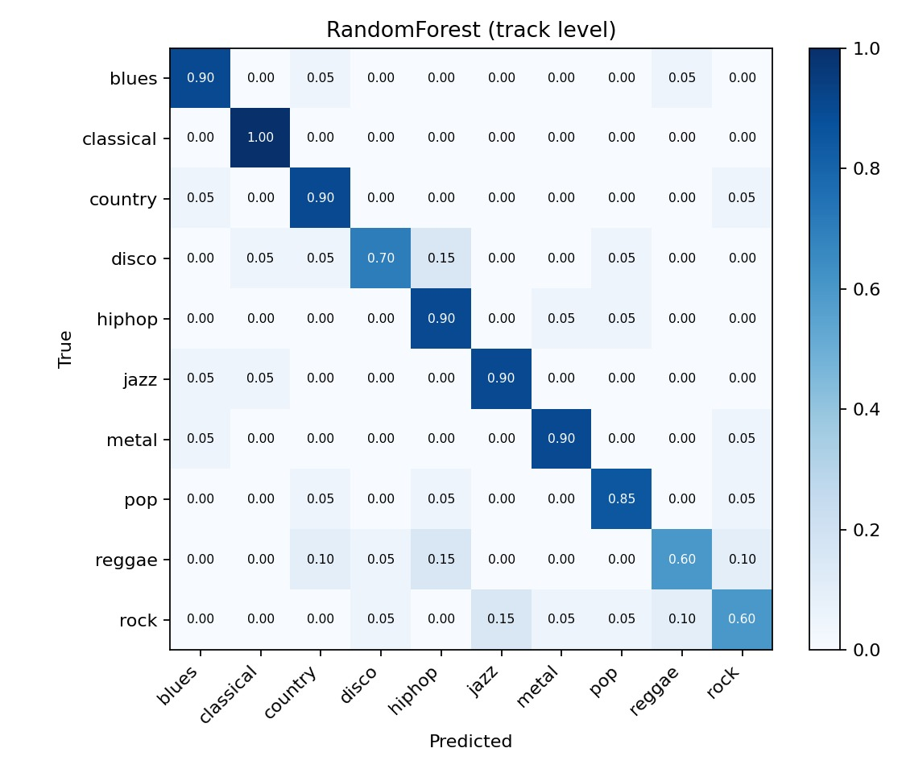
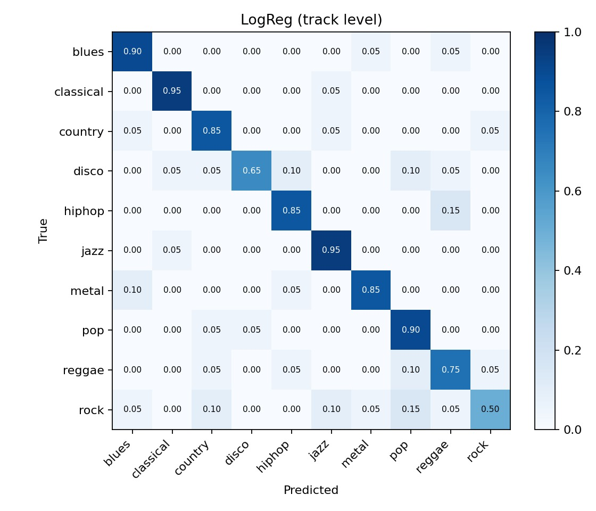
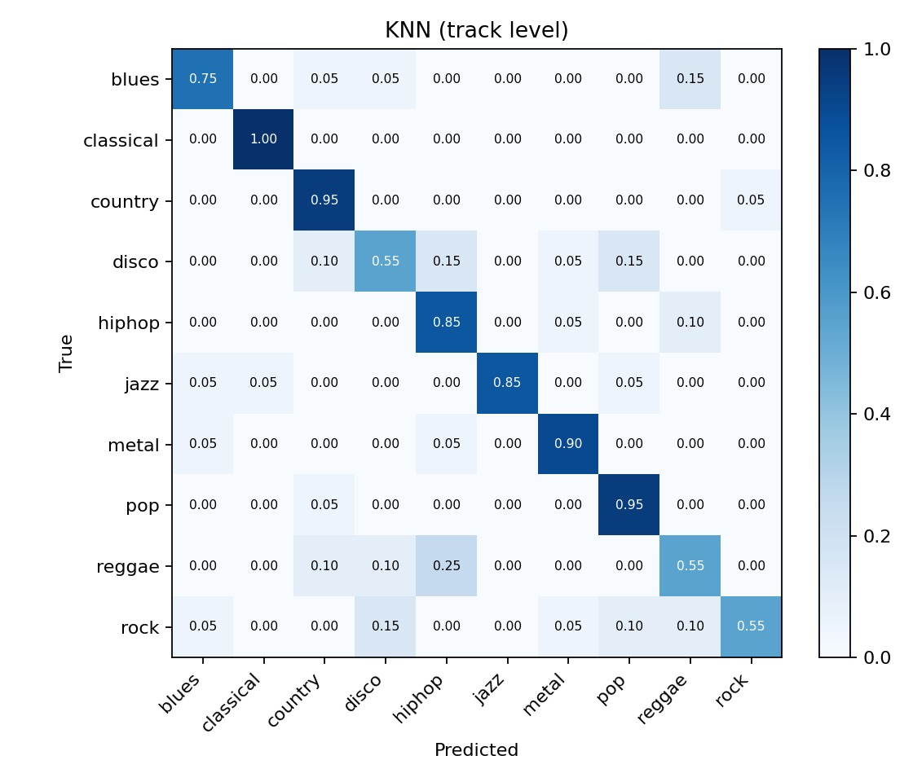

# 🎵 Music Genre Classification

Classifying 30-second audio clips into one of 10 genres using the GTZAN dataset, with two approaches: classical ML on hand-crafted audio features, and a CNN on log-mel spectrograms. Includes a Streamlit web app for live predictions.

**Team:** `S Prithika (PES2UG24CS415)` · `Samanvith Kashyap (PES2UG24CS432)`

---

## Problem Statement

Given an audio clip, predict its genre (blues, classical, country, disco, hiphop, jazz, metal, pop, reggae, rock). Automatic genre tagging is useful for music metadata, search and recommendation systems.

## Dataset

[GTZAN Dataset – Music Genre Classification (Kaggle)](https://www.kaggle.com/datasets/andradaolteanu/gtzan-dataset-music-genre-classification)

- 1000 tracks, 10 genres × 100 tracks, 30 s each, mono, 22,050 Hz
- Each track is cut into ten 3 s segments (about 10,000 samples)
- Known issues: `jazz.00054.wav` is corrupt (skipped automatically), and GTZAN has some repeated and mislabeled tracks

Place the audio so the layout looks like this:

```
data/genres_original/
├── blues/      *.wav
├── classical/  *.wav
├── ...
└── rock/       *.wav
```

## Approach

| | Pipeline A: Classical ML | Pipeline B: Deep Learning |
|---|---|---|
| **Input** | 88 hand-crafted features per segment (MFCC, chroma, spectral contrast, centroid, bandwidth, rolloff, ZCR, RMS; mean and std) | 128-bin log-mel spectrogram (128 × 130) |
| **Models** | KNN (with PCA), Logistic Regression, Random Forest, SVM (RBF) | 4-block CNN (Conv → BatchNorm → ReLU → MaxPool → Dropout), global average pooling, dense head |
| **Training** | GridSearchCV with GroupKFold (5 folds, grouped by track) | Adam, SpecAugment, EarlyStopping, ReduceLROnPlateau |
| **Model selection** | Best by cross-validation score (never by test score) | Best validation accuracy checkpoint |

**Evaluation:** the train/val/test split (70/10/20) is done **per track and stratified by genre**, so segments of one song never appear in both training and test data. This avoids data leakage and gives honest accuracy numbers. Segment-level predictions are also averaged per track (voting), and we report both segment-level and track-level metrics.

## Project Structure

```
music-genre-classification/
├── README.md
├── requirements.txt
├── .gitignore
├── common.py              # config, audio loading, feature extraction, evaluation helpers
├── extract_features.py    # Step 1: builds features.csv and mel.npy, assigns track-level splits
├── train_classical.py     # Step 2: KNN / LogReg / RF / SVM with grouped CV
├── train_cnn.py           # Step 3: CNN on mel-spectrograms with SpecAugment
├── app.py                 # Step 4: Streamlit live demo
├── demo_songs/            # sample songs for the live demo
├── screenshots/           # result figures used in this README
├── best_classical.joblib  # trained best classical model (SVM-RBF)
├── cnn_best.keras         # trained CNN
├── classical_results.json, cnn_results.json
├── cm_*.png, cnn_curves.png
└── data/
    └── genres_original/   # GTZAN audio (git-ignored)
```

Files generated by running the scripts (the trained models, metrics and plots are already committed to this repo, so the demo works without retraining):

- `data/features.csv`, `data/mel.npy` (extracted features)
- `best_classical.joblib`, `cnn_best.keras` (trained models)
- `classical_results.json`, `cnn_results.json` (metrics)
- `cm_*.png`, `cnn_curves.png` (confusion matrices and learning curves)

## Setup

```bash
python -m venv .venv
source .venv/bin/activate        # Windows: .venv\Scripts\activate
pip install -r requirements.txt
```

## How to Run

Run these in order from the project root:

```bash
python extract_features.py   # ~10-20 min, creates data/features.csv and data/mel.npy
python train_classical.py    # trains and tunes the 4 classical models
python train_cnn.py          # trains the CNN (GPU / Colab recommended)
streamlit run app.py         # launches the live demo
```

### Running on Google Colab

1. Runtime → Change runtime type → **T4 GPU**
2. Clone the repo and `%cd` into it
3. Install extras only: `!pip install -q librosa soundfile tqdm` (don't reinstall TensorFlow)
4. Download GTZAN with `kagglehub` using your Kaggle API token, and copy `genres_original` into `data/genres_original`
5. Run the three scripts with `!python <script>.py`
6. Save the models and results to Google Drive before the runtime disconnects

## Results

Evaluated on the held-out test tracks (20% of tracks, never seen during training or tuning).

| Model | CV Acc | Segment Acc | Track Acc | Track Macro-F1 |
|---|---|---|---|---|
| KNN | 0.672 | 0.682 | 0.790 | 0.785 |
| Logistic Regression | 0.694 | 0.707 | 0.815 | 0.810 |
| Random Forest | 0.714 | 0.734 | 0.825 | 0.821 |
| **SVM (RBF)** | **0.755** | 0.777 | **0.855** | **0.853** |
| CNN (423k params) | – | **0.763** | 0.825 | 0.819 |

- Best classical model by cross-validation: **SVM (RBF)**, C=50, gamma="scale".
- Track-level voting improves every model by roughly 8-10 points over segment-level accuracy.
- On this small dataset the SVM on hand-crafted features slightly outperforms the CNN at track level; the CNN is competitive at segment level.

### CNN training curves



### Confusion matrices (track level, test set)

| CNN | SVM (RBF) |
|---|---|
|  |  |

| Random Forest | Logistic Regression | KNN |
|---|---|---|
|  |  |  |

The same plots are also saved as `cm_*.png` and `cnn_curves.png` by the training scripts.

## Live Demo

`streamlit run app.py`, then upload a `.wav`, `.mp3`, `.au` or `.ogg` file. The app picks 10 evenly spaced 3 s segments, runs the selected model (CNN or classical), averages the predictions, and displays the predicted genre, a probability bar chart and the mel-spectrogram.

## Limitations and Future Work

- GTZAN is small and has known flaws (duplicates, mislabeled tracks), which limits generalization
- Genres that overlap musically (e.g. rock/country/blues, jazz/classical) are the most commonly confused
- Future work: transfer learning (VGGish, YAMNet), CRNN architectures, larger datasets such as FMA

## Team Contributions

| Member | Contributions |
|---|---|
| `Prithika` | `extract_features.py`, `train_classical.py`, feature and config parts of `common.py` |
| `Samanvith` | `train_cnn.py`, `app.py`, evaluation helpers in `common.py` |

## References

- Tzanetakis & Cook, "Musical genre classification of audio signals", IEEE Trans. Speech and Audio Processing, 2002
- Park et al., "SpecAugment: A Simple Data Augmentation Method for ASR", 2019
- librosa, scikit-learn, TensorFlow/Keras, Streamlit documentation
